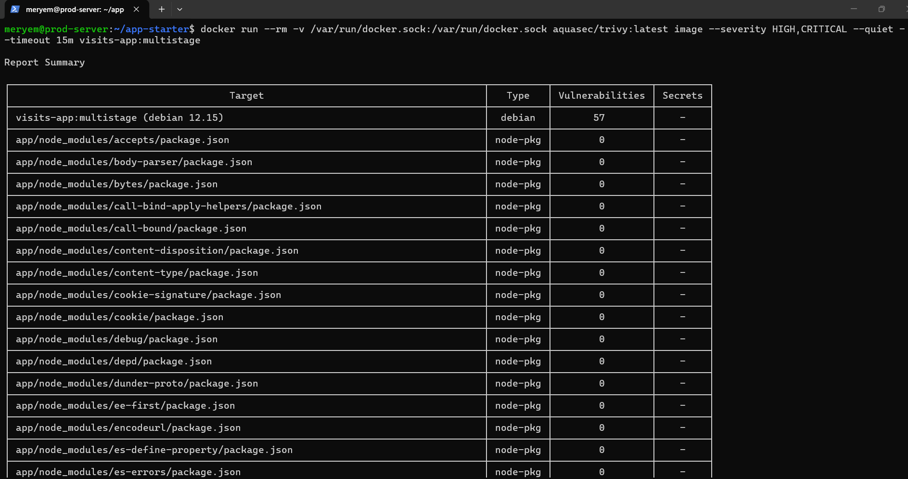
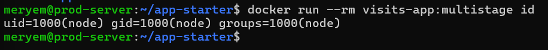
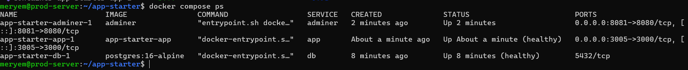
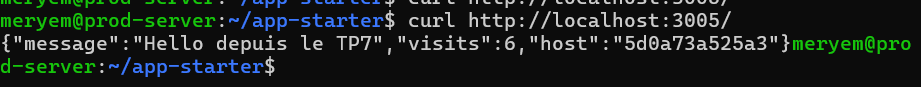
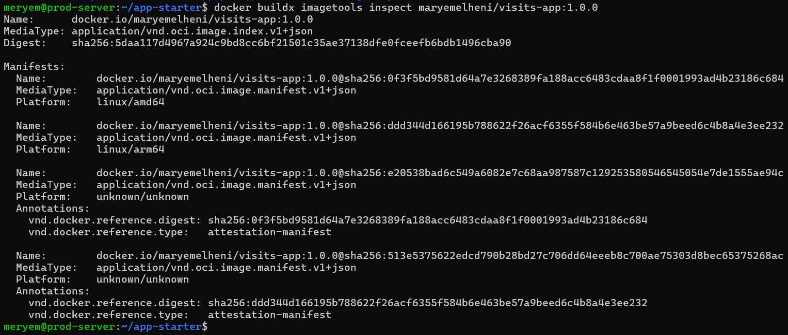
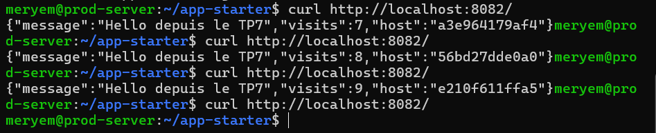

# Rapport TP7 : Docker avancé et Docker Compose

## 1. Comparaison des images (naïve vs multi-stage)

| Indicateur | naive | multistage |
|---|---|---|
| Taille de l'image | 1.67 Go | 337 Mo |
| Temps de build (à froid) | ~12 min | ~3 min 35 s |
| Temps de build (code modifié) | ~20 s | ~10 s |
| Vulnérabilités HIGH/CRITICAL | 488 | 57 |
| Utilisateur | root (uid=0) | node (uid=1000) |

Le multi-stage a permis de réduire la taille de l'image de **80%** et les vulnérabilités de **88%**, tout en passant d'un utilisateur root à un utilisateur non-privilégié (`node`).

## 2. Analyse du cache Docker
- L'image naïve copie tout le contexte (`COPY . .`) avant de faire `npm install`, ce qui invalide le cache à chaque modification de code.
- L'image multi-stage sépare les étapes : `deps` (copie uniquement `package*.json` puis `npm ci`), `build` (compilation), `runtime` (image finale légère).
- Grâce au `.dockerignore`, le contexte de build est réduit (exclusion de `node_modules`, `dist`, `.git`, `.env`).

## 3. Pile Docker Compose
La pile `compose.yaml` contient 3 services :
- **db** : PostgreSQL 16, avec volume nommé `pgdata`, healthcheck `pg_isready`, réseau `backend`.
- **app** : l'application Node.js, dépend de `db` avec `condition: service_healthy`, réseaux `frontend` et `backend`.
- **adminer** : outil d'administration, réseau `backend`.

Le fichier `.env` contient les variables sensibles (ignoré par Git).

## 4. Persistance des données
Après un `docker compose down` puis `up -d`, le compteur de visites a été conservé (grâce au volume `pgdata`).

## 5. Buildx et multi-architecture
L'image a été construite pour `linux/amd64` et `linux/arm64` avec `docker buildx build --platform linux/amd64,linux/arm64 --push`.
Le manifeste (`docker buildx imagetools inspect`) confirme les deux architectures.

## 6. Défi (reverse proxy)
J'ai ajouté un service Nginx comme reverse proxy devant 3 instances de l'application (`--scale app=3`).
Les `curl` successifs montrent que le champ `host` change (a3e964179af4, 56bd27dde0a0, e210f611ffa5), prouvant la répartition de charge.

## 7. Difficultés rencontrées
- **Conflits de ports** : les ports 3000 et 8080 étaient déjà utilisés sur la VM, j'ai dû les décaler (3005 et 8081).
- **Espace disque** : les images Docker et les builds multi-arch ont rempli la VM (89%), j'ai dû faire un `docker system prune -a --volumes`.
- **Réseau lent** : les téléchargements d'images (Node.js, Trivy) ont été longs, j'ai utilisé `--timeout 15m` pour Trivy.
## 8. Captures d'écran

### Comparaison des images

### Utilisateur non-root

### Conteneurs Docker Compose

### Persistance des données

### Manifest multi-architecture

### Reverse proxy (défi)

