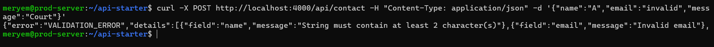
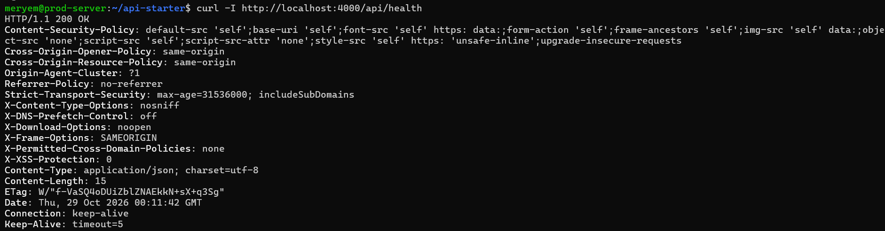
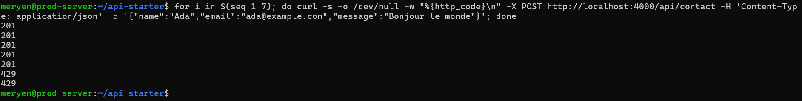
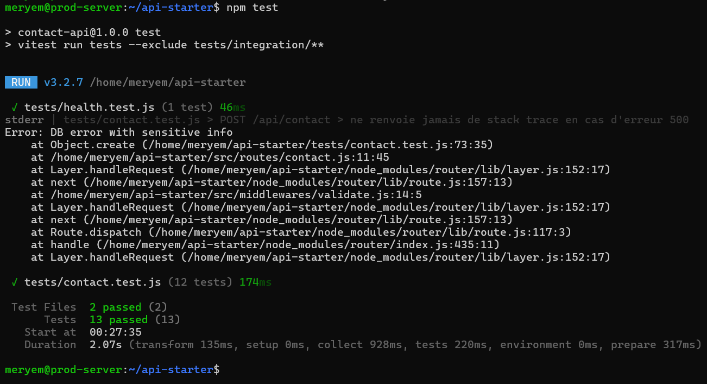
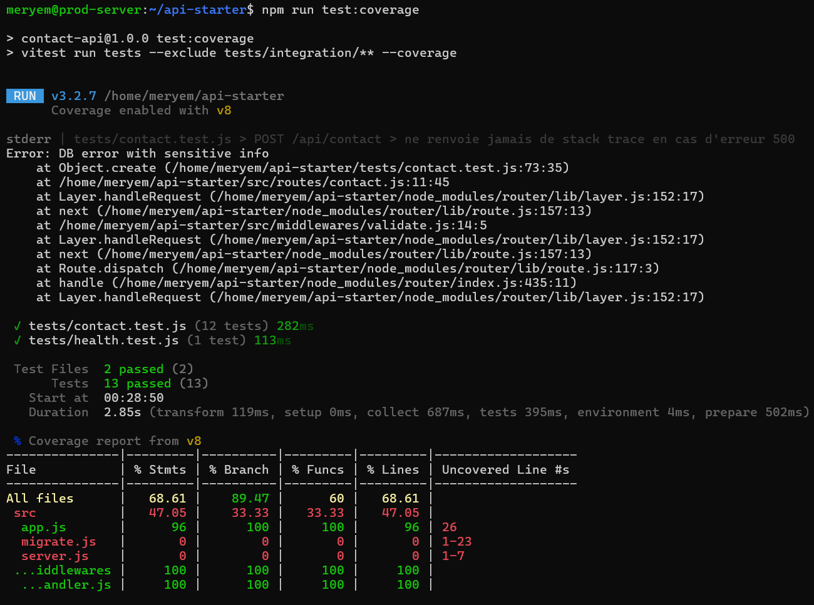
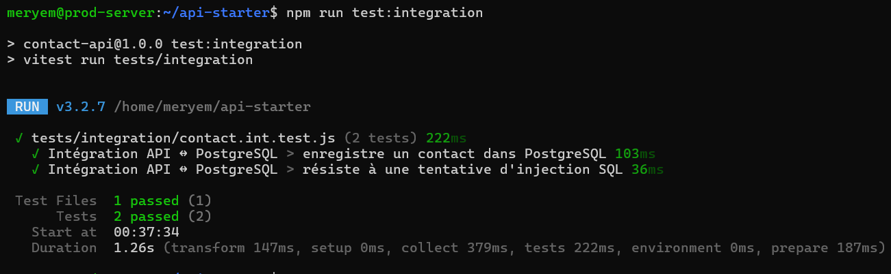

# Rapport TP8 : API Express sécurisée et testée

## 1. Tableau OWASP API Security Top 10

| Risque OWASP | Concerne notre API ? | Mesure dans ce TP |
|---|---|---|
| API1 Broken Object Level Authorization | Non (pas d'objets utilisateur) | - |
| API2 Broken Authentication | Non (pas d'auth dans ce TP) | - |
| API3 Broken Object Property Level Authorization | Oui | `.strict()` refuse les champs en trop (mass assignment) |
| API4 Unrestricted Resource Consumption | Oui | rate limiting (5 req/min), taille max du corps (10 ko) |
| API8 Security Misconfiguration | Oui | Helmet, pas de stack trace, pas de `x-powered-by` |

## 2. Validation et gestion des erreurs
Le schéma Zod (`src/schemas/contact.js`) valide strictement `name` (2-100), `email` (format email, ≤254), `message` (10-2000) avec `.strict()`. Le middleware `validate.js` renvoie une erreur 400 avec `VALIDATION_ERROR` et les détails des champs invalides.

Le middleware `errorHandler.js` gère `INVALID_JSON` (400), `PAYLOAD_TOO_LARGE` (413) et `INTERNAL_ERROR` (500), sans jamais divulguer la stack trace.

## 3. Durcissement HTTP
- `app.disable("x-powered-by")` supprime le header `X-Powered-By`.
- `helmet()` ajoute les headers de sécurité (CSP, HSTS, X-Frame-Options, etc.).
- `express.json({ limit: "10kb" })` limite la taille du corps.
- `express-rate-limit` limite à 5 requêtes/minute sur `/api/contact`.

## 4. Tests
Les 13 tests de routes passent (Vitest + Supertest), couvrant :
- Cas valides et invalides (email, champs manquants, types inattendus).
- JSON mal formé, corps trop volumineux.
- Injection SQL stockée telle quelle.
- Absence de stack trace en cas d'erreur 500.
- Headers Helmet et absence de `X-Powered-By`.
- Rate limiting (429).

La couverture est de **68.61%** globalement, avec **96%** sur `app.js` et **100%** sur les middlewares.

## 5. Intégration PostgreSQL
Les tests d'intégration (`tests/integration/contact.int.test.js`) utilisent un vrai PostgreSQL lancé avec Docker Compose. Ils vérifient :
- L'enregistrement d'un contact en base.
- La résistance à une injection SQL (la table existe toujours, la valeur est stockée telle quelle).

## 6. Difficultés rencontrées
- **Conflit de ports** : le port 5432 était déjà utilisé, j'ai dû utiliser Docker Compose pour isoler la base.
- **Variables d'environnement** : le fichier `.env` devait correspondre aux variables du `compose.yaml` (`PGUSER`, `PGPASSWORD`, `PGDATABASE`).
- **Base de données non vide** : les tests d'intégration échouaient car la table contenait déjà des données, j'ai ajouté un `TRUNCATE TABLE` dans le `beforeAll`.

## 7. Captures

### Erreur de validation

### Headers de sécurité

### Rate limiting

### Tests unitaires

### Couverture

### Tests d'intégration

